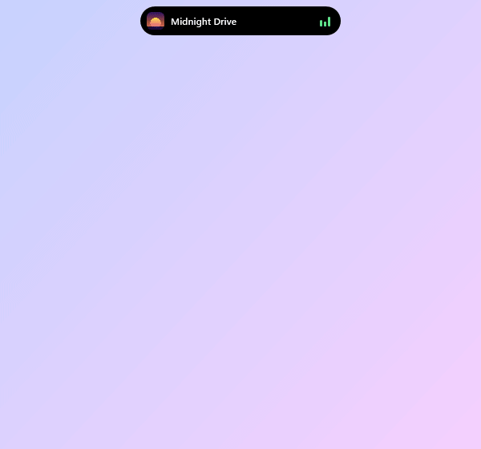
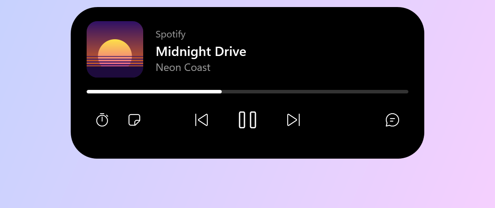
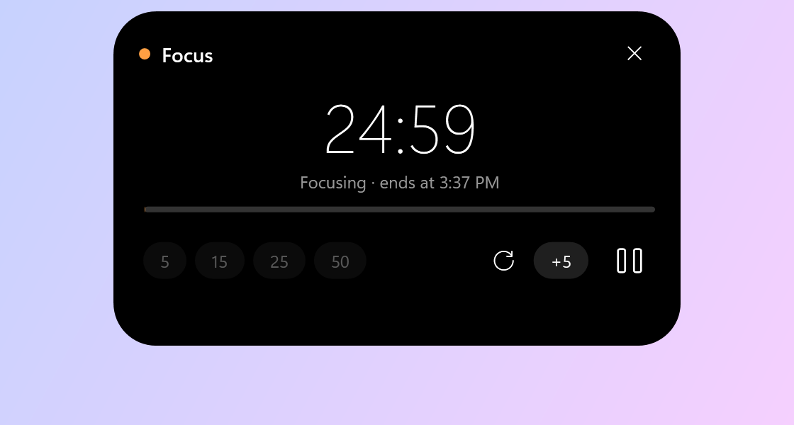
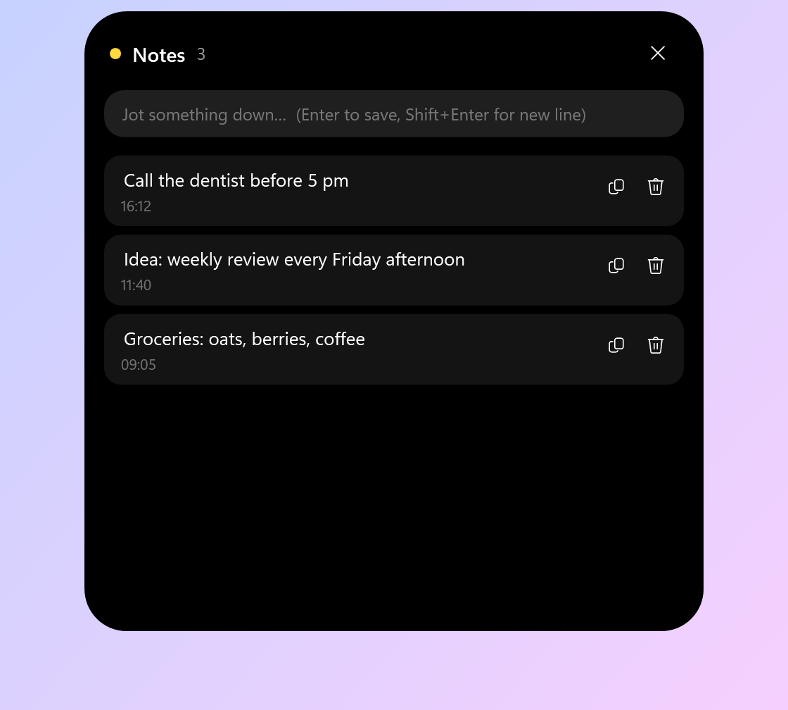
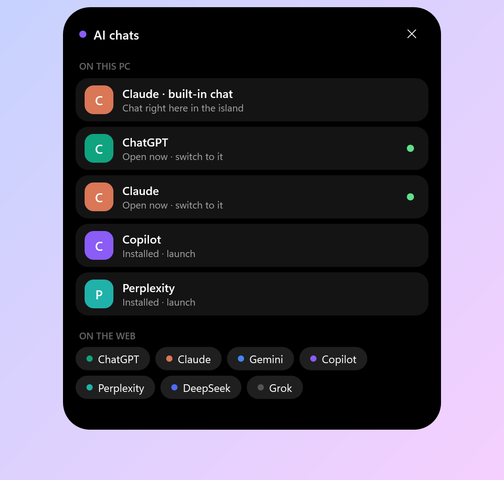
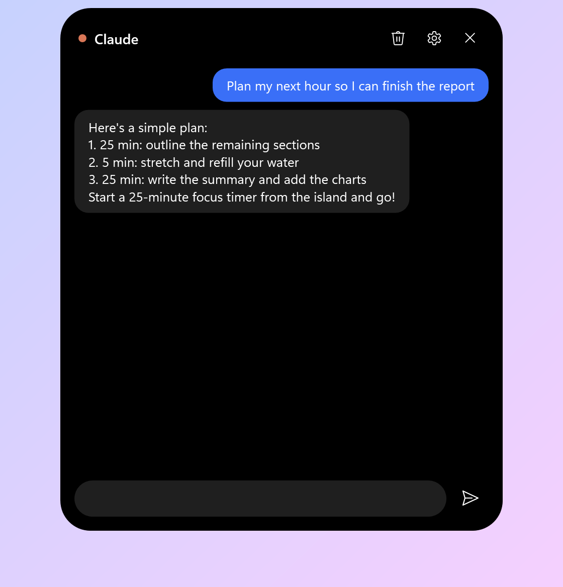

  

<h1 align="center">Winland</h1>

A floating island for Windows — music controls, a focus timer, quick notes and all your AI chats, one hover away.

  
  
  

<b><a href="../../releases/latest">⬇ Download the latest version</a></b>

  

---

## Install

1. Download **`Winland-win-Setup.exe`** from the [latest release](../../releases/latest).
2. Double-click it. Winland installs for your user account (no admin rights needed) and starts right away.
3. If Windows shows **"Windows protected your PC"**, click **More info → Run anyway**.
   Winland isn't code-signed yet, so Windows shows this for new apps.

Requires Windows 10 (version 2004 or newer) or Windows 11, 64-bit.

To uninstall: **Settings → Apps → Winland → Uninstall**.

## What it does

- **Now playing** — hover the pill for song, artist, album art and play/pause/skip. Works with Spotify, YouTube in your browser, Media Player and more.
- **Focus timer** — 5 to 50-minute sessions with a countdown in the pill, the time your session ends, and a chime when it's done.
- **Quick notes** — type, press Enter, done.
- **AI chats** — jump to ChatGPT, Claude, Copilot, Gemini or any other AI app on your PC, open one on the web, or chat with Claude right inside the island (needs your own Anthropic API key).

Right-click the island or its tray icon for: Start with Windows · Hide during full-screen apps · Hide for 1 hour · Quit.

## Screenshots

<table>
  <tr>
    <td align="center"> <b>Now playing</b></td>
    <td align="center"> <b>Focus timer</b></td>
  </tr>
  <tr>
    <td align="center"> <b>Quick notes</b></td>
    <td align="center"> <b>AI chats</b></td>
  </tr>
  <tr>
    <td align="center"> <b>Compact island</b></td>
    <td align="center"> <b>Built-in chat</b></td>
  </tr>
</table>

## Privacy

No accounts, no analytics, no tracking. Notes and settings stay on your PC.
Messages are sent to Anthropic only if you use the built-in Claude chat with your own key.

---

© 2026 monmeeth-env. All rights reserved. Winland is free to download and use; the source code is not public.
